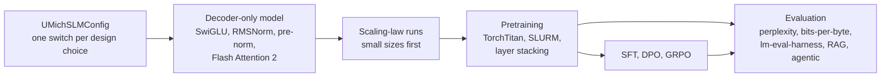

<div align="center">

# UMichSLM

**A modular transformer codebase for studying efficient small language models: every architecture choice is one config switch, so experiments stay apples-to-apples.**

The codebase behind the University of Michigan's first small language model, a decoder-only family up to about 1B parameters.

[How it works](#how-it-works) &nbsp;·&nbsp; [Highlights](#highlights) &nbsp;·&nbsp; [Architecture tour](about/architecture-tour.md) &nbsp;·&nbsp; [Setup](SETUP.md)


</div>

<!-- sync:banner -->
> **Snapshot, not the live codebase.** This is a periodically refreshed, reviewed snapshot of the project, taken from upstream commit `59b1552` (2026-11-10). Active development stays in a private repository, so recent work will not appear here.  
> Last synced: 2026-11-24
<!-- /sync:banner -->

## How it works, in one page

- **The problem:** comparing small-model designs fairly is hard when every new attention variant, position scheme or sparsity method means a fork of the model code. Differences in plumbing then hide the differences that matter.
- **What this is:** one decoder-only model whose every design choice (attention, positions, sparsity, recurrent layers, memory modules, training objectives, layer reuse) is selected through a single `UMichSLMConfig`. Changing one choice never means forking the model.
- **How it's used:** scaling-law runs pick a design at small sizes before committing GPU budget; the chosen configuration is pretrained, then fine-tuned (SFT, DPO, GRPO) and evaluated on perplexity, bits-per-byte, lm-eval-harness, RAG and agentic tasks.

The project was developed by a 15-person team at the University of Michigan. This repository is a reviewed public snapshot; see [About this repository](#about-this-repository).

---

## How it works



## Highlights

| Area | What is implemented |
| --- | --- |
| Attention | MHA, GQA, Multi-head Latent Attention (MLA), Gated DeltaNet / Kimi Delta Attention, sliding window with persistent global tokens, MoDA depth attention, Hymba hybrid attention-SSM, Griffin RG-LRU |
| Positions | RoPE, PoPE, learned RePo offsets, DRoPE training schedule |
| Sparsity | Mixture-of-Experts, progressive MoE, Mixture-of-Depths |
| Objectives | Sequential and parallel multi-token prediction, chunked cross-entropy |
| Memory | Engram hash n-gram memory, learnable meta and global tokens |
| Layer reuse | Block-wise weight sharing, layer-wise scaling, cross-layer KV sharing |
| Training | Layer-stacked pretraining with optimizer-state migration, SFT, DPO, GRPO, TorchTitan and SLURM launchers |
| Evaluation | Perplexity and bits-per-byte, lm-eval-harness, RAG and agentic evaluation paths |

The model is HuggingFace-compatible and uses modern defaults: SwiGLU, RMSNorm, pre-norm blocks and Flash Attention 2.

## Start here

- **[Architecture tour](about/architecture-tour.md)**: a feature-by-feature walkthrough of the design, from configuration to training and evaluation.
- **[Setup](SETUP.md)**: environment and installation.
- **[docs/](docs/)**: architecture presets, evaluation, memory requirements, scaling experiments, SLURM workflows, TorchTitan speed tests and YaRN.
- **[Changelog](CHANGELOG.md)**: what changed in each snapshot.

## Repository layout

```
src/umich_slm/        model, configuration and every architectural module
tests/                unit tests for each component
configs/              training, SLURM and TorchTitan configurations
scripts/              pretraining, SFT, evaluation and analysis entry points
evals/                evaluation configurations and runners
torchtitan_train/     TorchTitan-based training loop
chinchilla_experiments/, scaling_experiments/   scaling-law runs and summaries
docs/                 reference documentation
```

## About this repository

This repository is a **snapshot** of the project, not the live codebase. Active development stays in a private repository, so the newest work will not appear here. Cluster paths, account names and email addresses have been replaced with placeholders such as `/path/to/data`, so some launch scripts need local paths filled in before they run.

## License

Released under the MIT License. See [LICENSE](LICENSE).
